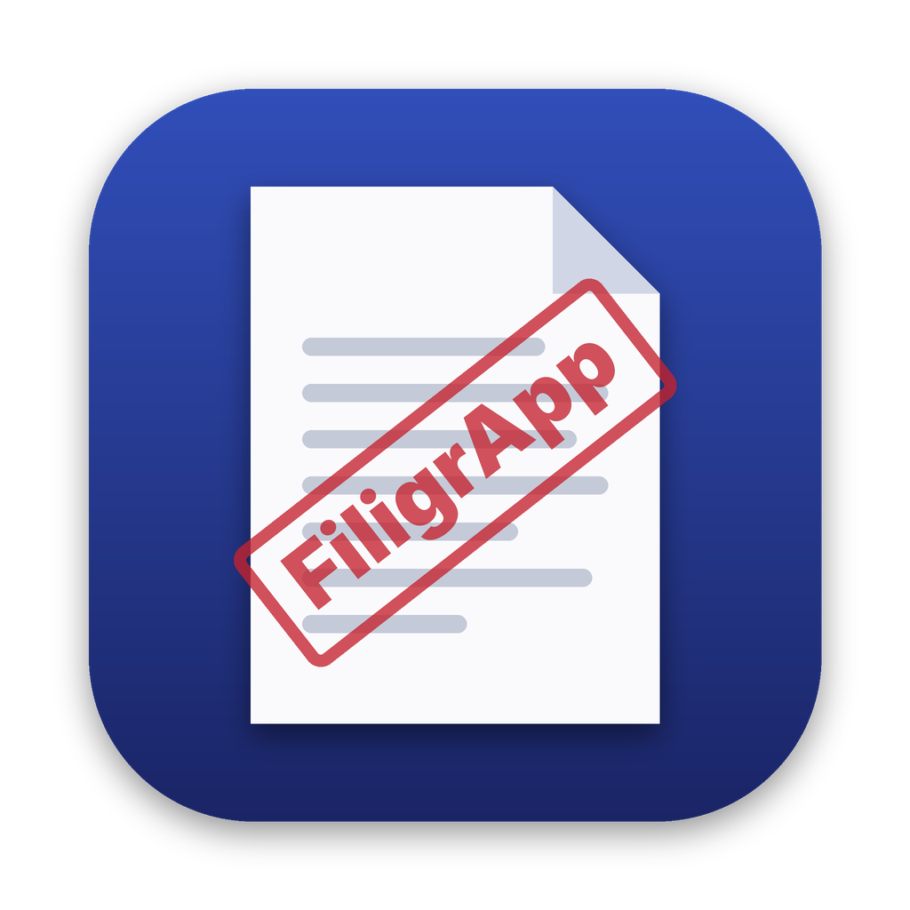

<p align="center"></p>

# FiligrApp

Petite application macOS pour ajouter un filigrane texte à des documents PDF, entièrement en local : aucune connexion Internet, aucune dépendance, vos fichiers ne quittent jamais votre Mac.

## Fonctionnalités

- Glisser-déposer d'un ou plusieurs PDF (dans la fenêtre ou sur l'icône de l'appli)
- Texte, couleur, taille, opacité et angle réglables
- Disposition centrée ou en mosaïque
- Aperçu en direct de la première page
- Les originaux ne sont jamais modifiés : un nouveau fichier « nom - filigrane.pdf » est créé

## Installation

Nécessite macOS 12 ou plus récent et les outils de développement d'Apple (Xcode n'est pas nécessaire).

```bash
git clone <adresse-de-ce-dépôt>
cd FiligrApp
bash build.sh
```

Si les outils de développement ne sont pas installés, le script propose de les installer : acceptez, puis relancez-le.
`FiligrApp.app` est créée dans le dossier ; glissez-la dans Applications.

## Personnaliser l'icône

Remplacez `icon.png` par une image carrée (idéalement 1024 × 1024 px) puis relancez `bash build.sh`.

## Limites

- Les PDF protégés par mot de passe ne sont pas pris en charge.
- Les champs de formulaire et les annotations du PDF d'origine ne sont pas conservés.
- Un filigrane est dissuasif mais peut être retiré avec un éditeur PDF : ce n'est pas une protection forte.
